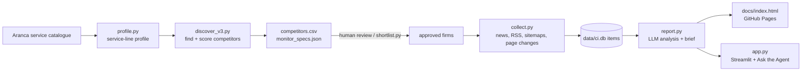

# Aranca CI Agent

A GenAI agent that finds boutique and mid-sized competitors of Aranca's Growth Advisory practice (US, KSA, UAE, India, Japan), monitors them every day from public sources, and turns what it finds into sourced, prioritised insights for Aranca's Practice Leaders.

- **Live dashboard (GitHub Pages):** TODO add URL
- **Interactive app (Streamlit):** TODO add URL
- **Daily run:** `.github/workflows/daily.yml` (08:00 IST, or press *Run workflow* for a demo)

## How it works



| Stage | Script | What the GenAI part does |
|---|---|---|
| Profile | `src/profile.py` | Builds Aranca's service-line profile from the catalogue CSVs; the LLM adds a short summary and search keywords per line. |
| Discovery | `src/discover_v3.py` | Free gates and local embeddings narrow thousands of sites; the LLM extracts a structured firm profile (type, size against a boutique/mid-sized rubric, region presence, overlap with Aranca's lines, verbatim evidence) in batches, and proposes extra firms for thin regions. Every LLM quote is checked against the source text. |
| Shortlist | `src/shortlist.py` | Picks `approved=yes` firms per region by relevance, monitorability and recent activity. Human `yes`/`no` decisions are kept. |
| Collection | `src/collect.py` | No LLM. Four sources per firm: news (Google News, with Bing/DuckDuckGo/Tavily fallbacks), the firm's RSS feed, sitemap diffing, and website page changes. Queries and aliases come from `data/monitor_specs.json`. |
| Analysis + report | `src/report.py` | The LLM classifies each item (Business Update, Deal, M&A, Digital Presence, Noise), scores relevance 0-5, writes a one-line summary, why it matters to Aranca, affected service lines and urgency, then one extra call writes an executive brief in which every bullet cites items. |
| Ask the Agent | `src/rag.py`, `app.py` | Local embeddings retrieve the relevant developments; the LLM answers only from them and cites sources. |

## Assignment requirements and where they are met

| Requirement | Implementation |
|---|---|
| Identify boutique and mid-sized competitors in 5 regions | `discover_v3.py`, output in `data/competitors.csv` (type, size class, region, overlap with Aranca service lines, score, evidence) |
| Track business updates, deals, M&A, digital presence | The four categories above, from `collect.py` sources |
| Autonomous daily monitoring | GitHub Actions workflow; state is committed back to the repo (`data/ci.db`) |
| Insights by company, geography, business segment | Filters and groupings by company, region and Aranca service line (segment) in `app.py` and the HTML dashboard |
| Source links and publication dates | Every item carries its URL and publication date from the source record, never from the LLM. Items without a publication date are dropped. |
| Dashboard for Practice Leaders | `docs/index.html` (static) and `app.py` (tab *By Practice Leader*) |

## Run it

Python 3.12.

```bash
pip install -r requirements.txt
cp .env.example .env            # add at least one LLM key (GROQ_API_KEY is enough)

python src/collect.py           # LOOKBACK_DAYS=2 for daily, 30-90 for a seed run
python src/report.py            # REPORT_DAYS=14 LLM_BUDGET=10
streamlit run app.py
```

Discovery (run once, or when a region needs more firms):

```bash
DRY_RUN=1 python src/discover_v3.py                  # no LLM, nothing written
SERVICE_EXPAND=1 LLM_BUDGET=20 python src/discover_v3.py
python src/shortlist.py                              # then review approved yes/no in data/competitors.csv
```

### GitHub Actions setup

1. Add repository secrets `GROQ_API_KEY` (required), `GEMINI_API_KEY` and `TAVILY_API_KEY` (optional).
2. Optional repository variable `LLM_PROVIDERS` (default `groq`; e.g. `groq,gemini` for fallback).
3. Settings > Pages > deploy from branch `main`, folder `/docs`.
4. Run the *daily-ci* workflow once manually to check it.

## Design decisions

- **Token efficiency.** Free gates run before any LLM call (domain blocklists, keyword gate, local embeddings, headcount and parent-company regex). Items are batched, the cheap model is the default, every uncached call counts against `LLM_BUDGET`, and all answers are cached in `data/llm_cache2.json`, so reruns are free. Token usage is printed at the end of each run.
- **Grounding.** Links and dates come from the database. Evidence quotes must appear verbatim in the text the model was shown or they are cleared. Brief bullets must cite real items or they are dropped.
- **Prompt-injection hygiene.** Scraped text is wrapped in tags and labelled untrusted, and the dashboards build their pages from text, not raw HTML.
- **Provider fallback.** `src/llm.py` tries providers in order and switches when a daily limit is hit.
- **Multilingual.** Arabic and Japanese queries, and a multilingual embedding model in discovery.

## Known limitations

- **LinkedIn posts are not collected.** LinkedIn requires a login to read posts. Each firm's LinkedIn URL is stored in `data/monitor_specs.json`, but post collection would need a paid data provider.
- **Google News blocks cloud IPs** (Codespaces, GitHub Actions). The collector detects this and uses Bing, DuckDuckGo, and optionally Tavily instead.
- **Boutiques publish little.** Many monitored firms have no news and post rarely, so a day's output can be small. The collector only reports items it can date.
- **Revenue and growth figures** appear only when a source states them; there is no financial-data feed.
- `data/aranca/*.csv` (the service catalogue extract) is not in the repo. `aranca_profile.json` and the RAG index are committed, so everything runs; add the CSVs to rebuild them.

## Repository layout

```
app.py                      Streamlit app
src/                        pipeline (llm, profile, discover_v3, shortlist, collect, report, rag)
data/                       competitors.csv, monitor_specs.json, aranca_profile.json, ci.db, llm cache, RAG index
reports/                    generated daily report (HTML + CSV)
docs/                       published dashboard (GitHub Pages)
.github/workflows/daily.yml daily automation
```

`src/discover.py` and `src/analyze.py` are earlier versions that the pipeline no longer uses.